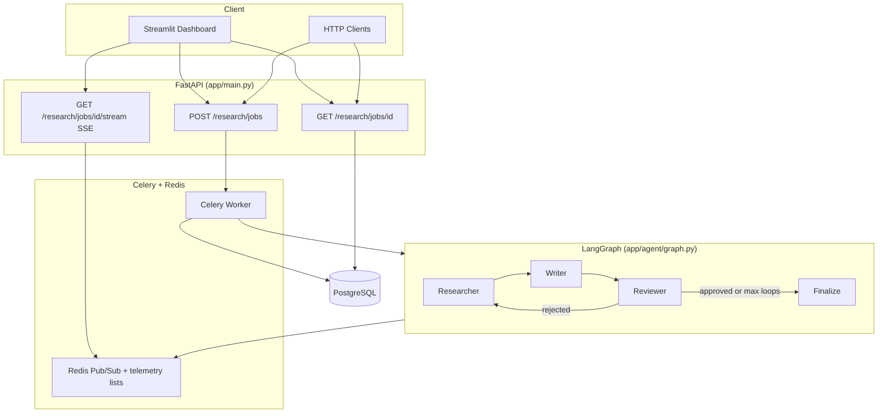

# Autonomous Multi-Agent Research & Reporting Engine

LangGraph-powered pipeline: **Researcher → Writer → Quality Reviewer** with a self-correction loop, PostgreSQL persistence, Celery background jobs, SSE telemetry, and a Streamlit operations dashboard.

## System architecture



## State machine specification

Graph state is defined by **`ResearchState`** (agent payload) and extended by **`ResearchGraphState`** for async orchestration.

| Field | Role |
|--------|------|
| `topic` | User research prompt |
| `search_queries` | Queries generated each loop |
| `raw_sources` | Scraped web facts (`url`, `title`, `content`, …) |
| `report_draft` | Current markdown report |
| `reviewer_feedback` | Actionable fixes when validation fails |
| `status` | Verification gate: `pending` → `approved` / `rejected` |
| `loop_count` | Self-correction iteration counter |
| `telemetry` | Append-only execution trace (Redis SSE + DB `trace_log`) |
| `job_status` | Persistence outcome: `completed` / `failed` |
| `final_payload` | Validated JSON (`sources_compiled`, `confidence_score`, `markdown_body`, …) |

During a **Celery** job, `app.tasks.tasks.run_agent_research` builds initial state, streams `agent_graph.astream(...)`, publishes node updates to Redis, and writes the merged final state to PostgreSQL via `persist_job_result`.

## Self-correction engineering

The **Reviewer** node combines deterministic checks (markdown section presence, URL reachability, citation heuristics) with an LLM gatekeeper. When validation fails, it sets `status: rejected`, increments `loop_count`, and fills `reviewer_feedback`. The conditional router `route_review_result` in `app/agent/graph.py` sends execution back to the **Researcher** while `loop_count < max_loops` (default **3**). This closes the loop without blocking the API thread. If the cap is exceeded, the graph routes to **Finalize** anyway—persisting the last draft with `job_status: failed` rather than hanging indefinitely.

## Stack

- **Orchestration:** LangGraph (`app/agent/graph.py`, `app/agent/nodes.py`)
- **Default reports:** Competitive intelligence
- **Search / scrape:** Tavily or Serper; Firecrawl or httpx + BeautifulSoup
- **API:** FastAPI
- **Jobs:** Celery + Redis (`app/tasks/tasks.py`)
- **DB:** PostgreSQL (SQLAlchemy async)
- **Dashboard:** Streamlit (`services/dashboard/`)

## Quick start

1. Copy environment file and set keys (minimum: `OPENAI_API_KEY` for full synthesis):

   ```bash
   cp .env.example .env
   ```

   **Local / Ollama (OpenAI-compatible):** set `OPENAI_API_BASE` to your Ollama server’s OpenAI endpoint, e.g. over Tailscale `http://100.x.x.x:11434/v1`, pull a model (`ollama pull qwen2.5`), set `OPENAI_MODEL` to that tag (e.g. `qwen2.5:latest`), and set `OPENAI_API_KEY` to any non-empty placeholder (e.g. `ollama`). Restart the API and Celery worker after changing `.env`.

2. Start infrastructure:

   ```bash
   docker compose up -d
   ```

3. Install dependencies:

   ```bash
   python -m venv .venv
   .venv\Scripts\activate
   pip install -r requirements.txt
   ```

4. Run API, worker, and dashboard (three terminals):

   ```bash
   uvicorn app.main:app --reload --port 8000
   celery -A app.tasks.celery_app worker --loglevel=info -P solo
   streamlit run services/dashboard/app.py
   ```

   Set `RESEARCH_API_URL` if the API is elsewhere. On Windows, prefer `http://127.0.0.1:8000` instead of `localhost` so the request does not hit another listener on IPv6 (`::1`), for example Docker’s proxy returning 404 on `/research/jobs`.

## API

**Create job**

```bash
curl -X POST http://localhost:8000/research/jobs ^
  -H "Content-Type: application/json" ^
  -d "{\"topic\": \"CRM SaaS competitive landscape\", \"focus_entities\": [\"Salesforce\", \"HubSpot\"]}"
```

**Poll result**

```bash
curl http://localhost:8000/research/jobs/{job_id}
```

**Stream telemetry (SSE)**

```bash
curl -N http://localhost:8000/research/jobs/{job_id}/stream
```

## Resilience stress test

Proves reviewer interception, monotonic `loop_count`, and max-loop termination:

```bash
python -m eval.stress_test
```

## Graph behavior

1. **Researcher** — generates queries, searches, scrapes into `raw_sources`.
2. **Writer** — structures Executive Summary, Key Findings, Competitive Landscape, Deep Dive with citations.
3. **Reviewer** — validator + LLM gatekeeper; on FAIL, loops to Researcher until `MAX_RESEARCH_ITERATIONS`.
4. **Finalize** — writes validated JSON to PostgreSQL.

## Dashboard views

| View | Purpose |
|------|---------|
| **Active graph path** | Highlights `[RESEARCHER] ──► [WRITER] ──► [REVIEWER]` from live telemetry |
| **Live correction console** | Surfaces rejections and `reviewer_feedback` routing messages in red |
| **Final document hub** | Rendered markdown, `.md` download, sidebar metadata JSON |
